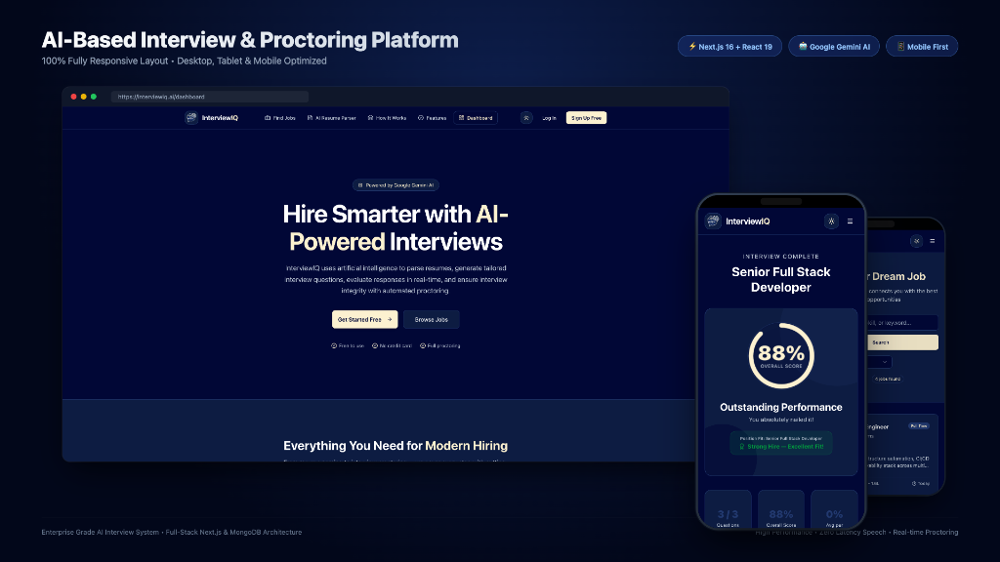
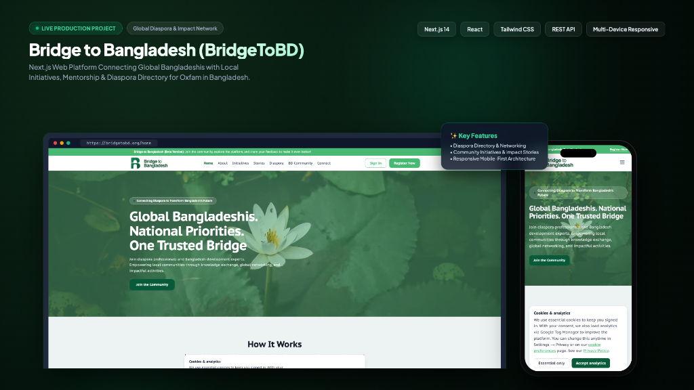
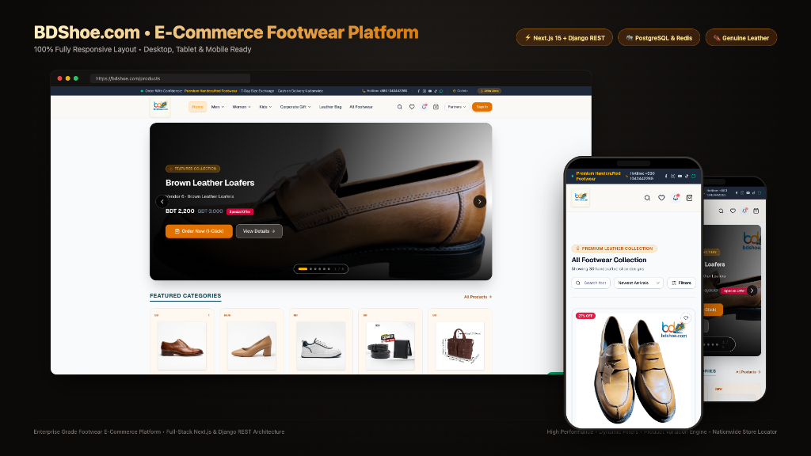
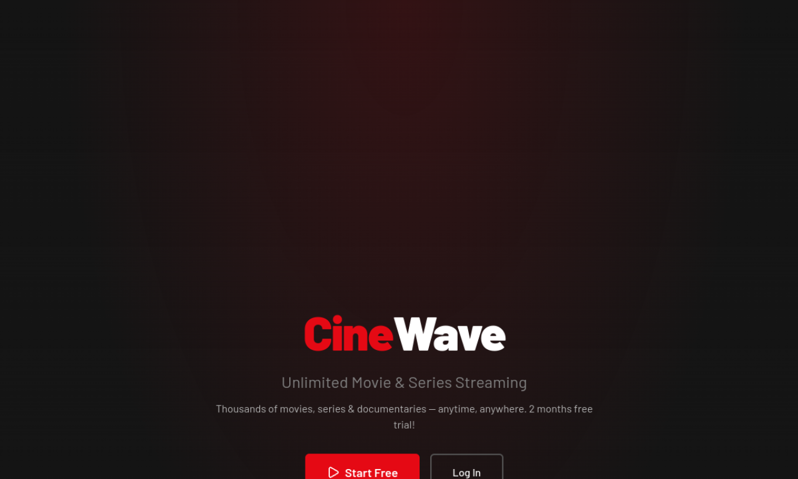
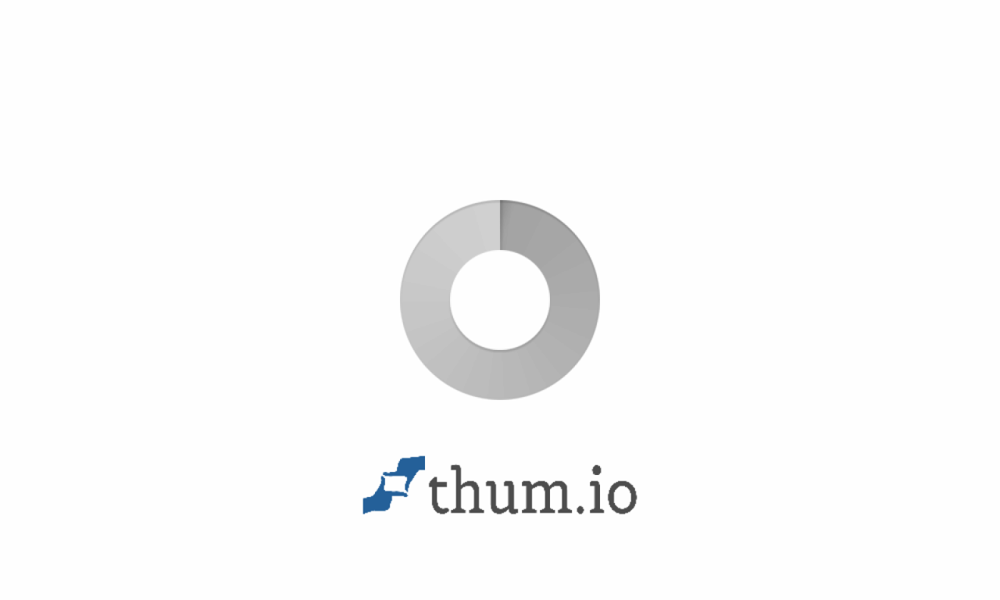

<div align="center">

```
 █████╗  ███████╗ ██╗ ███████╗    ██╗  ██████╗  ██████╗   █████╗  ██╗     
██╔══██╗ ██╔════╝ ██║ ██╔════╝    ██║ ██╔═══██╗ ██╔══██╗ ██╔══██╗ ██║     
███████║ ███████╗ ██║ █████╗      ██║ ██║   ██║ ██████╔╝ ███████║ ██║     
██╔══██║ ╚════██║ ██║ ██╔══╝      ██║ ██║▄▄ ██║ ██╔══██╗ ██╔══██║ ██║     
██║  ██║ ███████║ ██║ ██║         ██║ ╚██████╔╝ ██████╔╝ ██║  ██║ ███████╗
╚═╝  ╚═╝ ╚══════╝ ╚═╝ ╚═╝         ╚═╝  ╚══▀▀═╝  ╚═════╝  ╚═╝  ╚═╝ ╚══════╝
```

### `> Mid-Level Software Engineer & Full Stack Developer`

<p align="center">
  <b>Specializing in Scalable MERN Stack &bull; Next.js &bull; TypeScript &bull; AI-Powered SaaS &bull; Enterprise Systems</b>
</p>

<!-- ===== ANIMATED TYPING SVG ===== -->
<p align="center">
  <a href="https://git.io/typing-svg">
    
  </a>
</p>

<!-- ===== PROFILE BADGES ===== -->
<p align="center">
  <a href="https://asif-portfolio-three.vercel.app/" target="_blank"></a>&nbsp;
  <a href="https://www.linkedin.com/in/md-asif-iqbal-652473185/" target="_blank"></a>&nbsp;
  <a href="mailto:md.asifiqbal2008@gmail.com"></a>&nbsp;
  <a href="tel:+8801715779924"></a>&nbsp;
  
</p>

<!-- ===== HIGHLIGHT STATS PILLS ===== -->
<p align="center">
  &nbsp;
  &nbsp;
  &nbsp;
  &nbsp;
  
</p>

</div>

<!-- ===== ANIMATED DIVIDER ===== -->


<!-- ===== ABOUT ME ===== -->

##  &nbsp;About Me

> **Mid-Level Software Engineer** with **4 years** of hands-on professional experience building production-grade web applications using the **MERN stack**, **Next.js**, and **TypeScript**. Proven track record in developing AI-driven SaaS products, enterprise POS/ERP systems, and large-scale community platforms across **3 technology companies**. Experienced in architecting scalable full-stack solutions, optimizing database performance, leading end-to-end product delivery, and mentoring junior engineers.

```js
const asif = {
    name: "Md Asif Iqbal",
    role: "Mid-Level Software Engineer",
    experience: "4 Years",
    companies: 3,
    location: "Dhaka, Bangladesh 🇧🇩",
    education: "B.Sc. in Software Engineering — UIU, Dhaka (2019 – 2024)",
    currentCompany: "Revinr",
    
    focusAreas: [
        "🚀 Scalable Full-Stack Web Architecture (Next.js & MERN)",
        "🤖 AI-Driven SaaS & Proctored Interview Systems (Gemini AI)",
        "🛒 Enterprise POS & 61-Page ERP Systems",
        "⚡ Web Performance Tuning (+35% Page Speedup), RBAC & CI/CD"
    ],
    
    expertise: {
        frontend: ["Next.js 14-16", "React 18-19", "TypeScript", "Tailwind CSS", "Zustand", "Redux", "Shadcn UI"],
        backend:  ["Node.js", "Express.js", "Nest.js", "Django", "REST APIs", "SSR", "JWT", "OAuth 2.0"],
        database: ["MongoDB Atlas", "PostgreSQL", "MySQL", "Redis", "Mongoose ODM"],
        ai_media: ["Google Gemini AI", "WebRTC Video/Audio", "OpenCV", "Face Detection"],
        devops:   ["Docker", "Vercel", "GitHub Actions CI/CD", "Firebase", "Netlify", "Linux"]
    },
    
    metrics: {
        repositories: "69+",
        liveProjects: "10+",
        queryOptimization: "30% faster MongoDB operations",
        loadTimeReduction: "35% performance boost"
    },
    
    funFact: "I ship production-grade architectures while the world is fast asleep ☕→🚀"
};
```


<!-- ===== PROFESSIONAL EXPERIENCE ===== -->

##  &nbsp;Work Experience

<table>
<tr>
<td width="33%" valign="top">

### 🏢 **Revinr**
**Software Engineer**  
*Nov 2025 – Present &bull; Uttara, Dhaka &bull; Full-time*  

- 🌐 Contributing to scalable web applications using **TypeScript, React, Next.js, Node.js**, and cloud services.
- 🚀 Engineered and optimized frontend architecture for **[Bridge to Bangladesh](https://bridgetobd.org/)**, a high-traffic community platform serving thousands of global users.
- 🔔 Built real-time notification drops, interactive dashboards, and responsive interfaces with **Next.js & Tailwind CSS**.
- 🔌 Seamless REST API integrations ensuring high security, performance, and accessibility.

</td>
<td width="33%" valign="top">

### 🏢 **Naasmind**
**Software Engineer**  
*Nov 2025 – Nov 2026 &bull; Mirpur, Dhaka &bull; Full-time*  

- 🎯 Owned end-to-end development of multiple SaaS products using **Next.js, React, Node.js, and MongoDB**.
- 🤖 Designed and shipped an **AI-powered interview platform** leveraging **Google Gemini AI** for smart resume parsing, question generation, and candidate grading.
- 📊 Architected an **enterprise POS/ERP** system featuring billing, inventory, HR payroll, multi-branch reporting, and financial ledgers.
- 🛡️ Implemented **JWT, Google OAuth**, granular **RBAC**, and automated CI/CD with **80%+ test coverage**.

</td>
<td width="33%" valign="top">

### 🏢 **BulipeTech Ltd.**
**Software Engineer**  
*Feb 2023 – Sep 2025 &bull; Banani, Dhaka &bull; Full-time*  

- 📦 Shipped **three full-stack enterprise applications** from scratch, optimized for high concurrency, scalability, and strict data security.
- ⚡ Reduced page load times by **~35%** with code splitting, dynamic imports, and caching; boosted MongoDB query speeds by **30%** via schema indexing.
- 🧩 Built reusable React components with Context API & custom hooks, slashing new-feature delivery time by **25%**.
- 👥 Mentored **two junior engineers** through structured code reviews, pair programming, and technical onboarding.

</td>
</tr>
</table>


<!-- ===== TECH ARSENAL ===== -->

##  &nbsp;Tech Arsenal

<p align="center">
  
</p>

<table>
<tr>
<td width="33%" valign="top">

#### 🎨 Frontend
- **Frameworks:** Next.js 14/15/16, React.js 18/19
- **Languages:** TypeScript, JavaScript (ES6+)
- **Styling:** Tailwind CSS, Shadcn UI, CSS3, Bootstrap
- **State:** Zustand, Redux Toolkit, Context API
- **Animations:** Framer Motion, Tilt, Lottie

</td>
<td width="33%" valign="top">

#### ⚙️ Backend & Architecture
- **Engines:** Node.js, Express.js, Nest.js, Django
- **APIs:** RESTful API Design, SSR, Microservices
- **Databases:** MongoDB Atlas, PostgreSQL, MySQL
- **ORM / ODM:** Mongoose, Prisma
- **Caching:** Redis, Query Indexing, In-memory Cache

</td>
<td width="33%" valign="top">

#### 🛡️ Auth, DevOps & AI
- **Security:** JWT, OAuth 2.0, Google Auth, RBAC
- **AI & Video:** Google Gemini AI, WebRTC, OpenCV
- **DevOps:** Docker, GitHub Actions, Vercel, Netlify
- **Testing:** Jest, React Testing Library, Postman
- **Tools:** Git, Linux, Jira, Figma, VS Code

</td>
</tr>
</table>

<details>
<summary><b>📊 Detailed Skill Proficiency (Click to expand)</b></summary>
<br>

```text
Next.js / React.js (SSR, RSC)   ██████████████████████████████████████████████░░  95%
TypeScript / Modern JavaScript  ████████████████████████████████████████████░░░░  92%
Tailwind CSS / shadcn/ui        █████████████████████████████████████████████░░░  94%
MongoDB / Mongoose / Indexing   ████████████████████████████████████████████░░░░  90%
Node.js / Express.js / Nest.js  ██████████████████████████████████████████░░░░░░  88%
Zustand / Redux Toolkit         █████████████████████████████████████████░░░░░░░  86%
AI & Gemini Integration         ████████████████████████████████████████░░░░░░░░  85%
RESTful API & System Design     █████████████████████████████████████████░░░░░░░  88%
PostgreSQL / MySQL              ██████████████████████████████████████░░░░░░░░░░  82%
Docker / CI/CD / DevOps         ███████████████████████████████████░░░░░░░░░░░░░  75%
```

</details>


<!-- ===== FEATURED FLAGSHIP PROJECTS ===== -->

##  &nbsp;Featured Flagship Projects

<table>
<tr>
<td width="50%" valign="top">

### 🤖 [AI-Based Interview System](https://ai-based-interview-systems.vercel.app)
*(AI-Driven Enterprise Hiring Platform with Anti-Cheat Proctoring)*

<a href="https://ai-based-interview-systems.vercel.app" target="_blank">
  
</a>

<p>
  
  
  
  
  
  
</p>

- 🧠 **AI Resume Parsing & Matching:** Gemini-powered skill extraction and candidate-job fit analysis.
- 🎥 **Proctored Live Interviews:** WebRTC video interviews with real-time face detection, tab-switch deterrence, and full-screen enforcement.
- 📊 **Intelligent Scoring:** Automatic grading of candidate answers with detailed analytics reports.
- 👥 **Dual Dashboards:** Custom recruiter workflows & interactive candidate interview rooms.

🔗 [**Live Platform**](https://ai-based-interview-systems.vercel.app) &bull; 📂 [**Source Code**](https://github.com/md-asif-iqbal/Ai-Based-Interview-Systems)

</td>
<td width="50%" valign="top">

### 🇧🇩 [Bridge to Bangladesh](https://bridgetobd.org/)
*(Global Diaspora Community Engagement Platform)*

<a href="https://bridgetobd.org/" target="_blank">
  
</a>

<p>
  
  
  
  
  
</p>

- 🌍 **Global Diaspora Network:** Bridges non-resident Bangladeshis with national development initiatives and community networks.
- ⚡ **High-Performance Architecture:** Optimized frontend delivery serving thousands of active users with snappy sub-second page loads.
- 🔔 **Interactive Features:** Secure auth, member directories, community circle feeds, and real-time alerts.
- 📱 **Responsive & Accessible:** Fully compliant across desktop, tablet, and mobile views.

🔗 [**Visit Live Platform (bridgetobd.org)**](https://bridgetobd.org/)

</td>
</tr>

<tr>
<td width="50%" valign="top">

### 👟 [BD Shoes — Footwear E-Commerce](https://bdshoe.com)
*(Modern High-Performance E-Commerce Platform)*

<a href="https://bdshoe.com" target="_blank">
  
</a>

<p>
  
  
  
  
  
</p>

- ⚡ **Cutting-Edge Stack:** Built with Next.js 16 and React 19 for instantaneous page transitions and SEO optimization.
- 🛍️ **E-Commerce Flows:** Dynamic category filtering, instant search, wishlist, cart management with Zustand, and multi-step checkout.
- 📦 **Real-time Inventory:** Live stock indicator, size/color variant selectors, and customer review system.
- 🎨 **Pixel-Perfect UI:** Mobile-first responsive layout with clean visual hierarchy.

🔗 [**Visit Store (bdshoe.com)**](https://bdshoe.com)

</td>
<td width="50%" valign="top">

### 🎬 [CINEWAVE — Movie Streaming Platform](https://github.com/md-asif-iqbal/CINEWAVE-Movie-Platform)
*(Netflix-Inspired Video Streaming Service)*

<a href="https://cinewave-movie-platform.vercel.app/" target="_blank">
  
</a>

<p>
  
  
  
  
  
  
</p>

- 🎬 **Multi-Profile Accounts:** Up to 5 custom profiles per subscription account with tailored watch histories.
- 💳 **Monetization:** SSLCommerz payment gateway integration for monthly/annual subscription tiers.
- 🔐 **Authentication:** Google OAuth + Firebase phone OTP verification with secure session tokens.
- 🛠️ **Admin Management:** Comprehensive dashboard for uploading movies, series, trailers, and analytics.

🔗 [**Live Demo**](https://cinewave-movie-platform.vercel.app/) &bull; 📂 [**Source Code**](https://github.com/md-asif-iqbal/CINEWAVE-Movie-Platform)

</td>
</tr>

<tr>
<td width="50%" valign="top">

### 🎓 [NexLearn — AI-Powered Education](https://github.com/md-asif-iqbal/EDU-Platfrom-NexLearn)
*(Interactive LMS with Gemini AI Tutoring & Live Classrooms)*

<a href="https://edu-platfrom-nex-learn.vercel.app/" target="_blank">
  
</a>

<p>
  
  
  
  
  
</p>

- 🤖 **AI Study Suite:** 4 distinct Gemini AI tools for instant homework help, quiz generation, and summaries.
- 📹 **Live Classrooms:** Low-latency video lectures powered by integrated Jitsi Meet.
- 💳 **Global Payments:** Automated student checkout & teacher payouts via Stripe.
- 📊 **3-Tier Role Management:** Dedicated dashboards for Students, Tutors, and Administrators across 27 routes.

🔗 [**Live Demo**](https://edu-platfrom-nex-learn.vercel.app/) &bull; 📂 [**Source Code**](https://github.com/md-asif-iqbal/EDU-Platfrom-NexLearn)

</td>
<td width="50%" valign="top">

### 🛒 [SoftLanding POS — 61-Page Enterprise ERP](https://github.com/md-asif-iqbal/SoftLanding-POS-system)
*(Full-Scale Retail, Inventory & HR Management ERP)*

<a href="https://soft-landing-pos-system-v2.vercel.app/" target="_blank">
  
</a>

<p>
  
  
  
  
  
</p>

- 🛒 **Rapid POS Terminal:** Real-time barcode scanning, receipt generation, multi-payment calculation, and discount logic.
- 📈 **14 Financial Modules:** Automated Profit & Loss, sales tax, stock valuation, and multi-format export (PDF/Excel/CSV).
- 👥 **HR & Payroll Engine:** Staff attendance, role privileges (RBAC), salary ledgers, and branch performance metrics.
- 🏢 **Multi-Branch Operations:** Centralized warehouse inventory tracking and intra-store transfers.

🔗 [**Live Demo**](https://soft-landing-pos-system-v2.vercel.app/) &bull; 📂 [**Source Code**](https://github.com/md-asif-iqbal/SoftLanding-POS-system)

</td>
</tr>
</table>


<!-- ===== ACHIEVEMENTS & CERTIFICATIONS ===== -->

## 🏆 Achievements & Certifications

<table>
<tr>
<td width="33%" align="center">

### 📜 JavaScript (Intermediate)
**HackerRank Certified &bull; 2024**  
<br>
Demonstrated advanced JavaScript concepts, closures, asynchronous patterns, and algorithmic problem-solving.  
<br>
<a href="https://www.hackerrank.com/certificates/iframe/9c8b39c8ec09" target="_blank">
  
</a>

</td>
<td width="33%" align="center">

### 🧩 Problem Solving (Basic)
**HackerRank Certified &bull; 2024**  
<br>
Validated data structure manipulation, algorithm complexity analysis, and logical reasoning proficiency.  
<br>
<a href="https://www.hackerrank.com/certificates/iframe/805e27d2e65e" target="_blank">
  
</a>

</td>
<td width="33%" align="center">

### 🥈 UIU Project Show
**1st Runner-Up &bull; 2023**  
<br>
Won 1st Runner-up across university-wide software engineering competition for innovative project design and architecture.  
<br>
<a href="https://drive.google.com/file/d/1GzfSj-jrAhndTK5fpfx1AY-rx-Sv-BO4/view" target="_blank">
  
</a>

</td>
</tr>
</table>


<!-- ===== EDUCATION ===== -->

## 🎓 Education

<table>
<tr>
<td width="50%">

### 🏛️ United International University (UIU), Dhaka
**B.Sc. in Software Engineering** &bull; *2019 – 2024*  
- **Major:** Software Engineering
- **Focus:** System Design, Object-Oriented Analysis & Design, Database Architecture, Web Technologies, Algorithms & Data Structures.

</td>
<td width="50%">

### 🏫 Adhyapak Abdul Majid College, Cumilla
**Higher Secondary Certificate (HSC) — Science** &bull; *2017 – 2019*  
- **Result:** **GPA 5.00 / 5.00** (Golden A+)
- **Focus:** Mathematics, Physics, Chemistry, Information & Communication Technology.

</td>
</tr>
</table>


<!-- ===== MORE PROJECTS (COLLAPSIBLE) ===== -->

<details>
<summary>
  <h3>
    
    📂 Explore All Notable Repositories & Deployments (Click to expand)
  </h3>
</summary>
<br>

#### 🌐 Full Stack & Frontend Applications

| # | Project | Tech Stack | Live / Repo | Highlights |
|:-:|:--------|:-----------|:-----------:|:-----------|
| 1 | **[Wathta Dashboard](https://github.com/md-asif-iqbal/Wathta-Dashboard-with-NextJS)** | Next.js 16, TypeScript, ShadCN, MongoDB | [🔗 Live Demo](https://wathta-dashboard-with-next-js-ndvq.vercel.app/) | Admin dashboard with analytics, Recharts & CRUD flows |
| 2 | **[Product Management](https://github.com/md-asif-iqbal/Product-management-with-nextJS)** | Next.js 15, Redux Toolkit, JWT, Zod | [🔗 Live Demo](https://product-management-with-next-js-2ek.vercel.app/products) | Full-stack catalog with RTK Query and authentication |
| 3 | **[NECX Messaging](https://github.com/md-asif-iqbal/NECX-Messaging-Frontend)** | React 18, Zustand, Vite 5, Node.js | [🔗 Live Demo](https://necx-messaging-frontend.vercel.app/) | Real-time chat with multi-persona switching & optimistic UI |
| 4 | **[BrightMind Blog](https://github.com/md-asif-iqbal/BrightMind-Blog-Fronend)** | React 18, TailwindCSS v4, MERN | [🔗 Live Demo](https://bright-mind-blog-fronend.vercel.app/) | Modern blog platform with JWT auth, admin panel, comments |
| 5 | **[Todo App](https://github.com/md-asif-iqbal/todo-list)** | Next.js, Zod, MongoDB | [🔗 Live Demo](https://todo-list-smoky-tau-27.vercel.app/) | Task management with schema validation & persistent data |
| 6 | **[Portfolio v2](https://github.com/md-asif-iqbal/Asifs-Portfolio)** | Next.js, TypeScript, Framer Motion | [🔗 Live Demo](https://asifsportfolio.vercel.app/) | Interactive 3D portfolio showcase |

#### 🏢 Enterprise & Management Platforms

| # | Project | Tech Stack | Live / Repo | Highlights |
|:-:|:--------|:-----------|:-----------:|:-----------|
| 7 | **[Courier & Parcel Management](https://github.com/md-asif-iqbal/Courier-Parcel-Management-System-Frontend)** | Node.js, MongoDB, React | [🔗 Live Demo](https://courier-parcel-management-system-v1.vercel.app/) | Parcel tracking, hub management & delivery routing |
| 8 | **[School Management](https://github.com/md-asif-iqbal/School-management)** | Next.js, TypeScript, MongoDB | [📂 Repository](https://github.com/md-asif-iqbal/School-management) | Student/teacher records, grading & attendance modules |
| 9 | **[E-KYC System](https://github.com/md-asif-iqbal/E-KYC-system-client-side)** | React, Node.js, MongoDB | [📂 Repository](https://github.com/md-asif-iqbal/E-KYC-system-client-side) | Digital identity verification and compliance flow |
| 10 | **[Leave Management](https://github.com/md-asif-iqbal/LEAVE_MANAGEMENT)** | PHP, MySQL | [📂 Repository](https://github.com/md-asif-iqbal/LEAVE_MANAGEMENT) | Employee leave request and administrative approval pipeline |

#### 🤖 AI, Machine Learning & Python

| # | Project | Tech Stack | Live / Repo | Highlights |
|:-:|:--------|:-----------|:-----------:|:-----------|
| 11 | **[Face Recognition Attendance](https://github.com/md-asif-iqbal/Face-regonization-attandance-system)** | Python, OpenCV, Haar Cascades | [📂 Repository](https://github.com/md-asif-iqbal/Face-regonization-attandance-system) | Computer vision attendance log with live camera stream |
| 12 | **[Django Job Portal](https://github.com/md-asif-iqbal/job_portal)** | Python, Django, SQLite | [📂 Repository](https://github.com/md-asif-iqbal/job_portal) | Job listing, candidate profiles & employer application portal |

#### 🎓 University & Community Initiatives

| # | Project | Tech Stack | Live / Repo | Highlights |
|:-:|:--------|:-----------|:-----------:|:-----------|
| 13 | **[UIU Crowdfunding App](https://github.com/md-asif-iqbal/uiu-crowdfounding-apps)** | React, Node.js, Express | [📂 Repository](https://github.com/md-asif-iqbal/uiu-crowdfounding-apps) | Campus initiative funding portal with payment tracker |
| 14 | **[UIU Club Forum](https://github.com/md-asif-iqbal/uiu-club-forum-client-side)** | React, Node.js | [📂 Repository](https://github.com/md-asif-iqbal/uiu-club-forum-client-side) | Student club collaboration and discussion forum |
| 15 | **[Blood Donation Platform](https://github.com/md-asif-iqbal/blood-donation)** | React, Express, MongoDB | [📂 Repository](https://github.com/md-asif-iqbal/blood-donation) | Donor-recipient geo-matching and urgent blood requests |

<p align="center">
  <i>⚡ ...and 50+ more repositories actively maintained!</i>
</p>

</details>

<p align="center">
  <a href="https://github.com/md-asif-iqbal?tab=repositories" target="_blank">
    
  </a>
</p>


<!-- ===== GITHUB ANALYTICS ===== -->

##  &nbsp;GitHub Analytics

<p align="center">
  <picture>
    <source media="(prefers-color-scheme: dark)" srcset="https://github-readme-stats-sigma-five.vercel.app/api?username=md-asif-iqbal&show_icons=true&theme=tokyonight&hide_border=true&bg_color=0d1117&title_color=00f2fe&icon_color=06b6d4&text_color=c9d1d9&ring_color=00f2fe&count_private=true&include_all_commits=true" />
    <source media="(prefers-color-scheme: light)" srcset="https://github-readme-stats-sigma-five.vercel.app/api?username=md-asif-iqbal&show_icons=true&theme=default&hide_border=true&count_private=true&include_all_commits=true" />
    
  </picture>
  <picture>
    <source media="(prefers-color-scheme: dark)" srcset="https://streak-stats.demolab.com?user=md-asif-iqbal&theme=tokyonight&hide_border=true&background=0D1117&ring=00f2fe&fire=06b6d4&currStreakLabel=00f2fe&sideLabels=c9d1d9&dates=8b949e&currStreakNum=c9d1d9&sideNums=c9d1d9" />
    <source media="(prefers-color-scheme: light)" srcset="https://streak-stats.demolab.com?user=md-asif-iqbal&theme=default&hide_border=true" />
    
  </picture>
</p>

<p align="center">
  <picture>
    <source media="(prefers-color-scheme: dark)" srcset="https://github-readme-stats-sigma-five.vercel.app/api/top-langs/?username=md-asif-iqbal&layout=compact&theme=tokyonight&hide_border=true&bg_color=0d1117&title_color=00f2fe&text_color=c9d1d9&langs_count=10" />
    <source media="(prefers-color-scheme: light)" srcset="https://github-readme-stats-sigma-five.vercel.app/api/top-langs/?username=md-asif-iqbal&layout=compact&theme=default&hide_border=true&langs_count=10" />
    
  </picture>
</p>

<!-- Profile Summary Cards -->
<p align="center">
  
  
  
</p>


<!-- Activity Graph -->
## 📈 Contribution Graph

<p align="center">
  <a href="https://github.com/md-asif-iqbal" target="_blank">
    
  </a>
</p>


<!-- ===== GITHUB TROPHIES ===== -->

## 🏆 GitHub Trophies

<p align="center">
  <a href="https://github.com/ryo-ma/github-profile-trophy" target="_blank">
    
  </a>
</p>


<!-- ===== CONTRIBUTION SNAKE ===== -->

## 🐍 Contribution Snake

<picture>
  <source media="(prefers-color-scheme: dark)" srcset="https://raw.githubusercontent.com/md-asif-iqbal/md-asif-iqbal/output/github-snake-dark.svg" />
  <source media="(prefers-color-scheme: light)" srcset="https://raw.githubusercontent.com/md-asif-iqbal/md-asif-iqbal/output/github-snake.svg" />
  
</picture>


<!-- ===== WHAT I'M UP TO ===== -->

##  &nbsp;What I'm Currently Up To

<table>
<tr>
<td>

🔭 &nbsp; Working on **Scalable Full-Stack Web Applications** & **AI-Driven SaaS**

🚀 &nbsp; Active Software Engineer at **Revinr**, architecting frontend for **[Bridge to Bangladesh](https://bridgetobd.org/)**

🤖 &nbsp; Engineered **[AI-Based Interview System](https://ai-based-interview-systems.vercel.app)** with **Google Gemini AI** & proctoring

👟 &nbsp; Shipped **[BD Shoes](https://bdshoe.com)** — modern Next.js 16 & React 19 footwear e-commerce

🛒 &nbsp; Developed **[SoftLanding POS](https://soft-landing-pos-system-v2.vercel.app/)** — 61-page enterprise ERP

🎬 &nbsp; Shipped **[CINEWAVE](https://cinewave-movie-platform.vercel.app/)** — full Netflix-style streaming platform

📚 &nbsp; Deep-diving into **Microservices Architecture**, **NestJS**, & **System Design**

💬 &nbsp; Ask me about **Next.js, TypeScript, React, Node.js, MongoDB, AI Integration**

⚡ &nbsp; Fun Fact: **4 Years of Experience**, **69+ repos**, always pushing production code!

</td>
<td>
  
</td>
</tr>
</table>


<!-- ===== CONNECT ===== -->

##  &nbsp;Let's Connect

<p align="center">
  <a href="https://asif-portfolio-three.vercel.app/" target="_blank">
    
  </a>&nbsp;
  <a href="https://www.linkedin.com/in/md-asif-iqbal-652473185/" target="_blank">
    
  </a>&nbsp;
  <a href="mailto:md.asifiqbal2008@gmail.com">
    
  </a>&nbsp;
  <a href="tel:+8801715779924">
    
  </a>&nbsp;
  <a href="https://github.com/md-asif-iqbal" target="_blank">
    
  </a>&nbsp;
  <a href="https://www.facebook.com/asifiqbal2008" target="_blank">
    
  </a>
</p>


<!-- ===== DEV QUOTE ===== -->

## 💭 Dev Quote of the Day

<p align="center">
  
</p>


<!-- ===== ANIMATED FOOTER ===== -->

<p align="center">
  <a href="https://git.io/typing-svg">
    
  </a>
</p>

<p align="center">
  <b>&ldquo;Dedicated to architecting intelligent, high-performance, and resilient systems that redefine digital experiences.&rdquo;</b>
</p>

<p align="center">
  ⭐ Crafted with passion by <a href="https://github.com/md-asif-iqbal">Md Asif Iqbal</a> &bull; If you find my projects helpful, feel free to drop a star!
</p>

<!-- ===== FOOTER ===== -->

